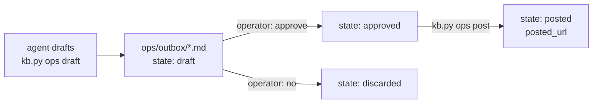

# Authority

The agent working in this KB can act on the outside world: commit, comment on issues, review PRs, dispatch coding sessions. This page and the `authority` block in `kb.config.json` say **how far it may go without asking**. The config file is the live setting. This page explains it.

## Levels

| Level | Meaning |
|---|---|
| `never` | The agent does not do this, even when asked mid-task. It tells the operator to do it, or to change the setting first. `kb.py ops post` refuses it |
| `ask` | The agent asks in the conversation and acts only after an explicit yes for **this** instance |
| `draft` | The agent prepares the action as an **outbox draft** (`ops/outbox/…`). It is posted only after the operator approves (`kb.py ops approve`, then `kb.py ops post`) |
| `auto` | The agent may do it on its own and reports what it did |

Approval is per instance. A "yes" for one comment is not a yes for the next one.

## Actions and defaults

| Action | Default | Notes |
|---|---|---|
| `kb_commit` | `ask` | Commit in this KB after a discussion (knowledge commit convention). Many owners raise this to `auto` |
| `kb_push` | `never` | Push the KB to its remote |
| `comment` | `draft` | Comment on an issue or PR/MR |
| `review` | `draft` | Submit a PR/MR review (comment, approve, request changes) |
| `label` | `draft` | Add labels |
| `assign` | `draft` | Assign people |
| `open_issue` | `draft` | Open a new issue (bugs found by QA, follow-ups) |
| `close` | `never` | Close an issue or PR/MR |
| `merge` | `never` | Merge a PR/MR |
| `push_code` | `never` | Push in a code repo |
| `dispatch_session` | `draft` | Send a goal to a coding session (the brief is written, and the operator starts or OKs the session) |
| `create_worktree` | `draft` | Create a git worktree or branch for a coding session |

Coding sessions follow their own repo's rules for commits and branches. They are set in each goal brief and the code repo's agent file ([kits/code-repo](../kits/code-repo/README.md)).

## The outbox flow

- A draft is a Markdown file. Its frontmatter holds the target (forge, repo, number, action, labels, review event). The body is the exact text to post. HTML comments (`<!-- … -->`) are notes for the operator and are **not posted**.
- The operator can edit the body before approving.
- The agent only runs `ops approve` when the operator has said so for that draft.

## Disclosure: never pass as the human

The agent usually posts through the owner's own forge account (the CLI login). So `kb.py ops post` puts a disclosure line **at the top of every text it posts** (comments, reviews, new issues, closing comments). Readers can't mistake it for the person:

| KB setting | First line posted |
|---|---|
| Public KB (`ops.kb_visibility: public` + `ops.kb_url`) | > ⚠️ **AI agent:** written by the [Project knowledge base](https://example.org/kb) agent, posted from owner's account. |
| Private KB | > ⚠️ **AI agent:** written by the Project knowledge-base agent, posted from owner's account. |
| Privacy mode (`privacy.enabled`) | > ⚠️ **AI agent:** written by an AI agent, posted from owner's account. *(never mentions the KB)* |

It is on by default (`ops.disclosure: true`). Turn it off only for a dedicated bot account whose name already says what it is. When the agent writes on a forge by any other route (e.g. calling `gh` directly), it adds the same line itself.

## Hard limits (regardless of settings)

- Never post as if you were the human. Every posted text starts with the disclosure line.
- Never write the real term behind an alias (`.kb-aliases.env`) into any file, commit or post. Use the alias.
- Never post secrets, tokens, private KB text or anything from `secrets/` to a forge.
- In privacy mode, never reference the KB from public repos ([session protocol](session-protocol.md)).
- Never mark anything `accepted`. Only the owner does.
- Never force-push, delete branches or rewrite published history.
