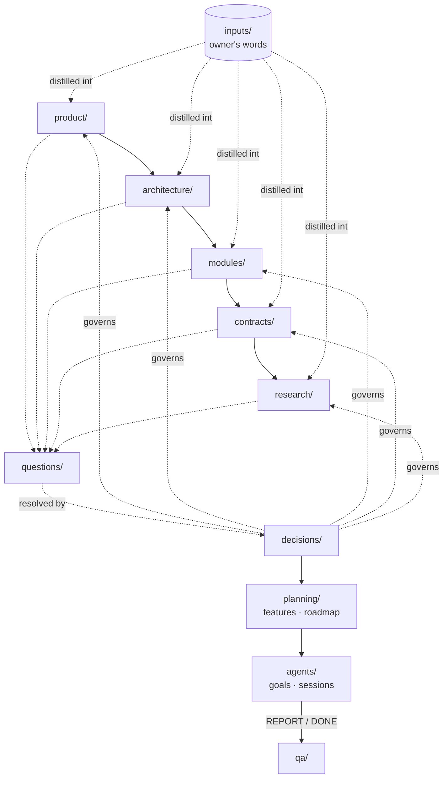

# Panelarr: knowledge base

> A self-hosted, arr-style app for curating, downloading, managing and reading manga, manhwa, manhua and comics, with real multi-user support and opt-in plugins for sources and metadata.

The **single source of truth** for Panelarr: what we're building and why, how, what's decided, what's open, and how delivery is going. The agent session **`panelarr-knowledge`** curates it and runs the project's day-to-day roles ([playbooks](playbooks/README.md)). **@aurimasniekis** decides what becomes `accepted`.

## Start here

1. [product/](product/README.md): Vision, principles, scope, personas
2. [architecture/](architecture/README.md): Cross-repo design: overview, domain model, deployment, security, repo standard
3. [Decisions](decisions/README.md): what is settled
4. [Open questions](questions/README.md): what isn't
5. [Roadmap](planning/roadmap.md): what's next
6. [AGENTS.md](AGENTS.md): how agents work here · [Conventions](meta/conventions.md)

## Map



## Areas

| Area | Holds | Index |
|---|---|---|
| **product/** | Vision, principles, scope, personas | [product/README.md](product/README.md) |
| **architecture/** | Cross-repo design: overview, domain model, deployment, security, repo standard | [architecture/README.md](architecture/README.md) |
| **modules/** | One sub-folder per repo: role, boundaries, internals, implementation status | [modules/README.md](modules/README.md) |
| **contracts/** | The reasoning behind APIs, protocols and file formats between repos | [contracts/README.md](contracts/README.md) |
| **research/** | Facts about external projects, libraries, standards | [research/README.md](research/README.md) |
| **planning/** | Roadmap, milestones, features with acceptance criteria, releases, status reports | [planning/README.md](planning/README.md) |
| **agents/** | Coding-session board, goal briefs, inbox for session messages | [agents/README.md](agents/README.md) |
| **qa/** | Test plans, test reports, regression list | [qa/README.md](qa/README.md) |
| **support/** | FAQ, known issues, reusable replies | [support/README.md](support/README.md) |
| **ops/** | Forge digests and the outbox of drafted comments and reviews | [ops/README.md](ops/README.md) |
| **playbooks/** | How the agent performs each role | [playbooks/README.md](playbooks/README.md) |
| **decisions/** | Decision records (ADRs) | [decisions/README.md](decisions/README.md) |
| **questions/** | Open-question register | [questions/README.md](questions/README.md) |
| **inputs/** | The owner's words, verbatim and immutable | [inputs/README.md](inputs/README.md) |
| **journal/** | One entry per working session | [journal/README.md](journal/README.md) |
| **meta/** | Conventions, commit convention, protocols, authority, glossary, templates | [meta/README.md](meta/README.md) |

## Roles the agent performs

Product owner, Project manager, Agent manager, QA / tester, Docs writer, Support. What it may do on its own is set in [authority](meta/authority.md). Default: everything that leaves this repo is drafted for approval.

## Working here

```sh
python3 tools/kb.py check                 # health check (the pre-commit hook runs it)
python3 tools/kb.py new adr "Use X for Y"  # next free ID + template + index row
python3 tools/kb.py ops digest            # issues and PRs across registered repos
git config core.hooksPath .githooks       # once per clone
```

Conventions: [meta/conventions.md](meta/conventions.md) · Commits: [meta/commit-convention.md](meta/commit-convention.md) · Agents: [AGENTS.md](AGENTS.md)

---

*Built from [llm-knowledge-base-template](https://github.com/aurimasniekis/llm-knowledge-base-template) ([NOTICE](NOTICE.md)).*
