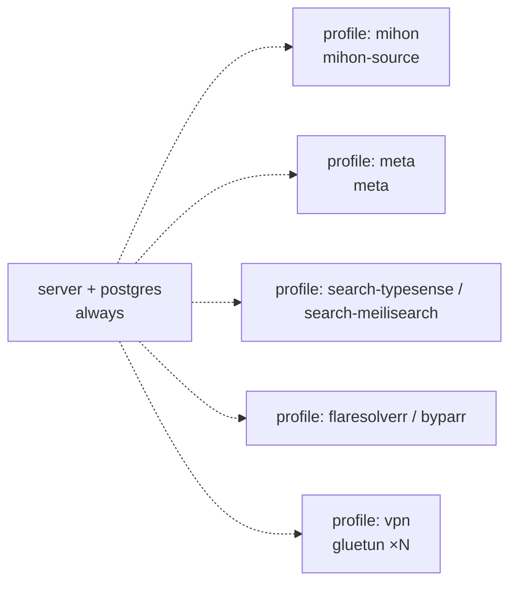

# Deployment

## Summary

Docker-first, *arr*-style: images `panelarr/<repo>` ([ADR-0008](../decisions/ADR-0008-public-repo-standard-and-images.md)). The minimal install is **only `panelarr/server`**. Everything else is added through **compose profiles** or extra Unraid templates ([ADR-0011](../decisions/ADR-0011-composable-opt-in-deployment.md)).

## Images

| Image | Contains | Needed? |
|---|---|---|
| `panelarr/server` | server + embedded web | **yes** |
| `panelarr/meta` | standalone meta service | optional |
| `panelarr/mihon-source` | JVM tool for Mihon extensions (+ optional Chromium variant `:<ver>-webview`, [Q-0002](../questions/README.md)) | optional |
| `panelarr/source-mihon`, `panelarr/source-local`, `panelarr/meta-*` | plugin in standalone/remote mode | optional (managed binaries are the default) |
| `postgres` | PostgreSQL, the only database ([ADR-0022](../decisions/ADR-0022-postgresql-only.md)). **Production setup: one server, one database per service**: server (the library) and meta each get their own (IN-0012). Dev setups may do whatever is convenient (IN-0013) | **yes** |
| third-party | typesense, meilisearch, flaresolverr/byparr, gluetun | optional |

## Compose profiles (deploy repo)

Example: `docker compose --profile mihon --profile flaresolverr --profile search-typesense up -d`

## Conventions
- Volumes `/config` and `/data`; `PUID`/`PGID`/`TZ`/`UMASK` env vars; healthchecks; a non-root user.
- Multi-arch images: `linux/amd64` and `linux/arm64`.
- **Ports** (Q-0005, IN-0015): server **8900**, meta **8901**, mihon-source **8902**. Plugins in standalone mode take 8903 and up (suggestion). Every port stays configurable.
- **Unraid:** Community Applications templates, one per image, in the deploy repo.
- **Later:** an AIO image (s6-overlay: server + mihon-source + optional meta) for the simplest installs; maybe a Helm chart.
- **Plugin discovery inside Compose** (mDNS/self-registration) is an open idea ([Q-0027](../questions/README.md)).
