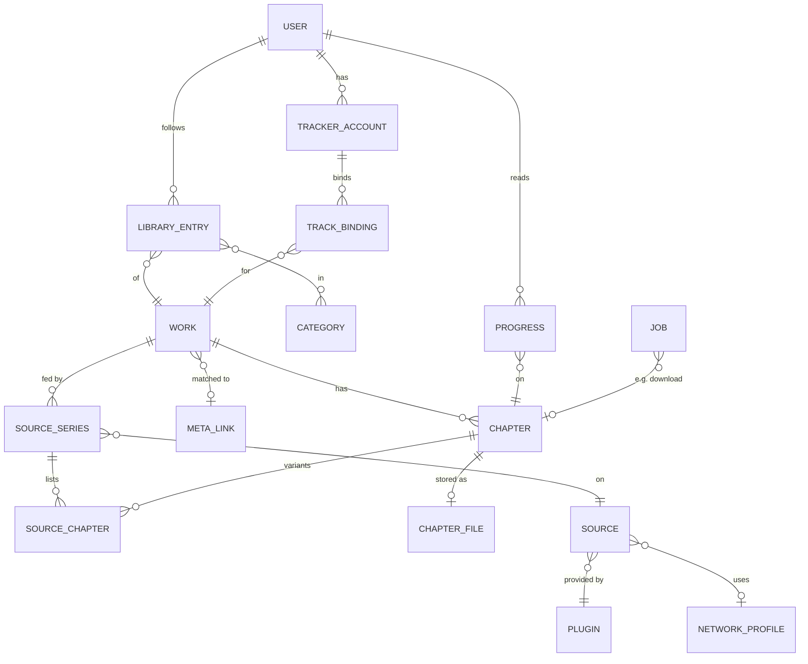

# Domain model

## Summary

The core idea: a **Work** is the canonical series. It is fed by one or more **SourceSeries** (the same series on different sources) and optionally linked to a **metadata record**. Chapters are merged across sources into canonical **Chapters**, each with a chosen variant and at most one stored **ChapterFile**. **Users never own content.** They own library entries, progress and tracker bindings that point at shared Works ([ADR-0003](../decisions/ADR-0003-shared-store-per-user-libraries.md)).

## Entities (server)

| Entity | Key fields | Notes |
|---|---|---|
| **Plugin** | id, kind, version, mode (managed/remote), endpoint, settings, enabled | Installed by the admin |
| **Source** | `plugin:sourceId`, name, lang, content rating, capabilities, profile_id, enabled | Synced from the plugin's `ListSources` |
| **NetworkProfile** | see [networking](networking.md) | |
| **Work** | id, display title, sort title, cover, status, content rating, meta_link | Canonical. Created when the first SourceSeries is added or a local file is adopted |
| **MetaLink** | provider ids (mangabaka, anilist, mal, …), confidence, locked | From meta matching; manual override locks it |
| **SourceSeries** | source_id, key (opaque plugin key), title, url, priority, preferred scanlators, last_checked | A Work has many; priority decides the preferred variant |
| **SourceChapter** | source_series_id, key, number, volume, title, scanlator, lang, uploaded_at | Raw listing |
| **Chapter** | work_id, number (decimal), volume, title, preferred_variant_id | Canonical. Variants are grouped by (number, volume) |
| **ChapterFile** | chapter_id, path, pages, bytes, sha256, from_variant_id, created_at | One copy, shared |
| **User** | id, name, password hash / OIDC subject, role, content-rating ceiling, quotas | |
| **Permission grants** | user → plugins/sources allowed, may_add, may_download, may_manage_meta | |
| **LibraryEntry** | user_id, work_id, added_at, categories, auto-download rule override | Per user |
| **Progress / History** | user_id, chapter_id, page, completed, updated_at | Per user; synced to trackers |
| **TrackerAccount / TrackBinding** | per user; remote id, status, score, dates | |
| **Job** | type, payload, state, attempts, next_run_at, lease, priority, limits key | DB-backed queue |
| **Rule** | download/update rules (global, per Work, per user library) | e.g. "download new chapters from preferred source" |

## Key rules
- **Variant choice:**
  - Preferred = highest-priority SourceSeries that has the chapter, filtered by preferred scanlators.
  - A user can force a different variant per Chapter (admin/curator).
- **Re-download:** when the preferred variant changes, the file is replaced only on explicit action or by a rule.
- **Deletion:**
  - Removing a Work from a library never deletes files.
  - Files are deleted only by admin action or a retention rule (e.g. "no library entries for N days").
- **Visibility:** a user sees a Work only if at least one of its sources is allowed for them, or it is local, *and* its content rating is within their ceiling.
