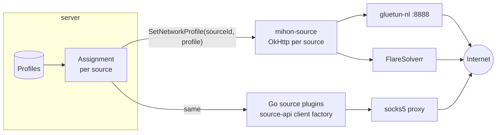

# Networking and network profiles

## Summary

Every source gets its own networking via a **network profile** ([ADR-0016](../decisions/ADR-0016-per-source-network-profiles.md), proposed). This fixes Suwayomi's global-only proxy and shared client ([research](../research/suwayomi-server.md)). server defines the profiles; source plugins enforce them in their own HTTP stack.

## Network profile

| Field | Meaning |
|---|---|
| `name` | e.g. `default`, `vpn-nl`, `tor`, `cf-heavy` |
| `proxy` | `http(s)://` or `socks5://` URL with optional auth. Empty means direct |
| `solver` | `{type: flaresolverr\|byparr, url, sessionTtl, maxTimeout, asResponseFallback}` |
| `rateLimit` | requests per interval, burst, per-host vs per-source |
| `concurrency` | max parallel requests (separate from download job limits) |
| `userAgent` | fixed, random-desktop, or "from solver" |
| `doh` | DNS-over-HTTPS provider (optional) |
| `headers` | extra headers |
| `cookies` | jar scope: per source (default) or shared with a named jar |
| `timeouts` | connect, read, call |

**Assignment:** `source → profile`. Each source falls back to its plugin's default profile, and that falls back to the global `default` profile.

## Enforcement per runtime
- **mihon-source (JVM):** one `OkHttpClient` per source, built from its profile. Extensions get it via Injekt `network.client`.
  - Proxy and auth go into the OkHttp `Proxy`/`Authenticator`. **No JVM-global system properties.**
  - The cookie jar is per source and persisted to files.
  - A **solver interceptor** handles 403/503 challenges (e.g. `Server: cloudflare`, a challenge body). It asks FlareSolverr/Byparr for clearance cookies and the UA, and solves are **coalesced per host**.
  - Rate limiting is per source, plus per host.
- **Go plugins:** `source-api/sdk/httpx.NewClient(profile)` gives an `http.Client` with the proxy dialer (SOCKS5 via `x/net/proxy`), the same solver round-tripper, rate limiter, cookie jar and DoH resolver.
- **Images:** page and image fetches use the same profile. Many CDNs check `Referer` and cookies, so the plugin owns image fetches end to end.

## VPN
- Panelarr never manages tunnels. A **VPN** is a container such as **gluetun** (OpenVPN or WireGuard) that exposes an HTTP/SOCKS proxy. A profile points at it (`vpn-nl → http://gluetun-nl:8888`). mihon-source documents this with a compose example (IN-0027, GOAL-0005).
- Alternative for "everything through the VPN": run the service in the VPN container's network (`network_mode: "service:gluetun"`). It is all or nothing, with no per-source choice, and the service's port must be published on the gluetun container.
- Not planned: services running OpenVPN/WireGuard themselves (needs NET_ADMIN and a tun device, which conflicts with hardening).
- Deploy offers compose profiles for one or more gluetun instances ([deployment](deployment.md)).

## Challenges that solvers can't pass
- Some sources need a real browser (JS challenges, WebView-only flows). Possible answers are a headless Chromium in or next to mihon-source ([Q-0002](../questions/README.md)), or marking the source as degraded and showing that to the admin.
