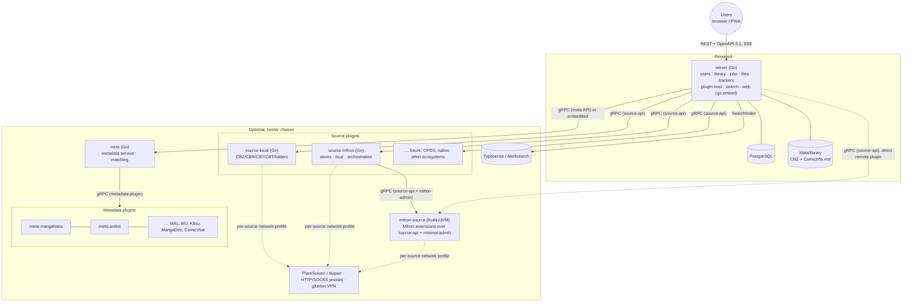
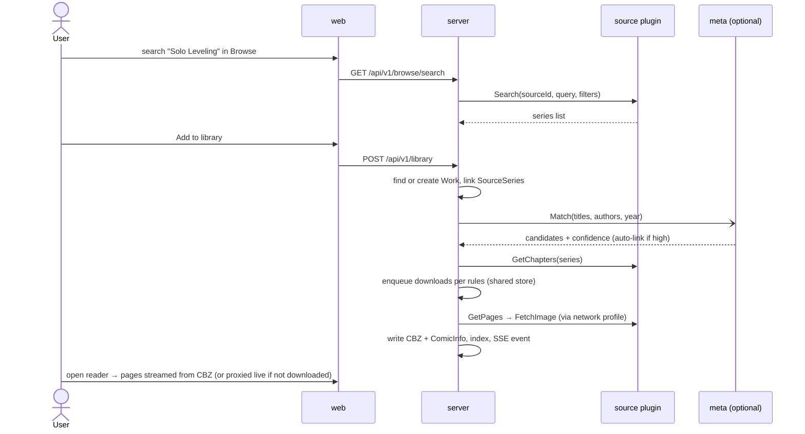

# Architecture overview

## Summary

Panelarr is a **Go core (`server`)** that serves a **React/TanStack PWA (`web`)** and hosts **opt-in plugins**: source plugins (Mihon via `source-mihon` + `mihon-source`, local files via `source-local`, more later) and metadata plugins (behind the optional **`meta`** service). Services talk over **protobuf/gRPC**. The browser talks **REST + OpenAPI + SSE**. Everything except `server` is optional ([ADR-0011](../decisions/ADR-0011-composable-opt-in-deployment.md)).

## Containers

## Responsibilities

| Component | Owns | Doesn't own |
|---|---|---|
| [server](../modules/server/overview.md) | Users, auth, permissions; Works and the source mapping; per-user libraries and progress; job queue (downloads, updates, refresh, re-index, tracker sync); files; plugin host; network profiles; search; trackers; REST API; serving web | Scraping, extension runtime, metadata aggregation |
| [web](../modules/web/overview.md) | All UI: library, browse, reader, admin; PWA and offline | Business rules |
| [source-api](../modules/source-api/overview.md) | Source-plugin protos, Go SDK, HTTP client factory honouring network profiles, conformance tests | Any concrete source |
| [source-mihon](../modules/source-mihon/overview.md) | Mihon extension stores, signing trust, install/update orchestration, caching | Running extensions |
| [mihon-source](../modules/mihon-source/overview.md) | Loading and running Mihon extensions; per-source OkHttp; prefs; speaks source-api | Stores, library, database |
| [source-local](../modules/source-local/overview.md) | Reading the user's archive and image folders as a source | Moving or modifying user files |
| [meta](../modules/meta/overview.md) | Metadata plugin host, aggregation, matching, metadata search | User data |
| [deploy](../modules/deploy/overview.md) | Compose profiles, Unraid templates, AIO image | — |

## Key flows

**Add a series from a source and read it**

## Cross-cutting docs
- [Contracts and transport](contracts-and-transport.md) · [Plugins](plugins.md) · [Networking](networking.md) · [Search](search.md)
- [Domain model](domain-model.md) · [Multi-user](multi-user.md) · [Storage layout](storage-layout.md) · [Trackers](trackers.md)
- [Security](security.md) · [Deployment](deployment.md) · [Repo standard](repo-standard.md)
