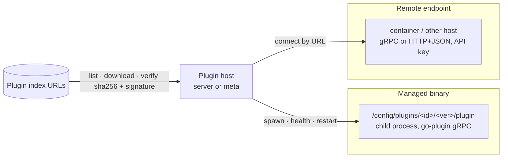

# Plugin system

## Summary

Sources and metadata providers are **plugins**. A fresh install has **none**; the hoster adds plugin indexes and installs what they want ([ADR-0009](../decisions/ADR-0009-plugins-not-bundled.md), accepted). Plugins run **out of process**, as managed binaries or remote endpoints, and speak versioned protobuf contracts ([ADR-0013](../decisions/ADR-0013-out-of-process-plugins.md), proposed).

## Kinds

| Kind | Contract | Host | Examples |
|---|---|---|---|
| `source` | `panelarr.source.v1` ([source plugin](../contracts/source-plugin.md)) | server | source-mihon, mihon-source (remote), source-local, future OPDS/native |
| `metadata` | `panelarr.metadata.v1` ([metadata plugin](../contracts/metadata-plugin.md)) | meta (or server when meta is embedded) | meta-mangabaka, meta-anilist, meta-mal, meta-mangaupdates, meta-kitsu, meta-mangadex, meta-comicvine |
| `tracker`? | — | server | Open: built in for now ([Q-0021](../questions/README.md)) |

## Run modes

1. **Managed binary.**
   - **Install:** the host fetches the artifact for its OS/arch from an index, verifies its SHA-256 and signature ([ADR-0014](../decisions/ADR-0014-plugin-index-and-signing.md)), and unpacks it into `/config/plugins/<id>/<version>/`.
   - **Run:** it spawns the plugin through **HashiCorp go-plugin** (handshake, gRPC over a local socket), restarts it on crash, and kills it on uninstall.
   - **Updates:** side-by-side install, then switch, with rollback on a failed health check.
2. **Remote endpoint.**
   - The admin enters a URL and API key. This is how JVM tools (mihon-source) or plugins on another machine plug in, and it is the **standalone** mode.
   - A managed plugin may also *launch nothing* and point at a remote: source-mihon points at mihon-source.

## Lifecycle and UX
- **Admin → Plugins:**
  1. Add an index URL (the first-run wizard *offers* the official index).
  2. Browse the plugins, then install, update or remove them.
  3. Configure each plugin through a **JSON-Schema settings** form (rendered by web).
  4. View health, logs and metrics.
- **Permissions:** an admin can restrict which plugins and sources each user may use ([multi-user](multi-user.md)).
- **Network:** a source plugin's sources get **network profiles** ([networking](networking.md)).
- **Rate limits:** each plugin declares them in `GetInfo`. The host enforces concurrency and rate limits centrally *and* the plugin enforces them too, as defence in depth.

## Discovery of remote plugins (seed idea, IN-0003 §7)

The author's idea: auto-detect plugins that run in the **same Docker Compose project**, e.g. mDNS. Discovery may only **suggest**. The admin still confirms and trusts the plugin, which keeps the [opt-in principle](../product/principles.md) intact.

| Mechanism | How | Pros | Cons |
|---|---|---|---|
| **mDNS / DNS-SD** | Plugins announce `_panelarr-plugin._tcp` with TXT records (kind, id, version, contract). server browses | Zero config inside one network; standard | Multicast generally works on one Docker bridge network **[unverified]**, but not across hosts, overlay networks or some macvlan/Unraid setups |
| **Self-registration** | The plugin is started with `PANELARR_URL` + a join token and calls `Register` on server | Works across hosts and networks; explicit | Needs a token generated in the UI first |
| **Compose DNS probing** | server probes well-known service names (`mihon-source:PORT`, …) and checks `GetInfo` | Trivial; no multicast | Only finds names we guessed |
| **Docker labels** | server reads container labels through the Docker socket | Rich metadata | Mounting the Docker socket is a security risk; must be opt-in |

Leaning (suggestion): use **mDNS + self-registration**, with discovered endpoints shown under *Admin → Plugins → Discovered* for one-click trust ([Q-0027](../questions/README.md)).

## Common plugin surface (all kinds)
- `GetInfo` (id, kind, version, contract versions, capabilities, declared limits).
- `GetSettingsSchema` / `GetSettings` / `SetSettings` (JSON Schema + values). This is how a plugin tells the main app **what config it expects**: for source-mihon, the extension repos/stores and its other settings. The main app renders and stores it (IN-0007 §1).
- **Common services:** a plugin declares in `GetInfo` which **common services** the main app offers that it can use (e.g. solvers, network profiles / proxies), and the main app supplies them (IN-0007 §1). The exact list is open.
- `Health`. Structured errors ([contracts and transport](contracts-and-transport.md)).

## SDKs
- **Go:** `source-api/sdk` and `meta/sdk` provide `plugin.Serve(impl)`. The same binary runs managed (go-plugin handshake) or standalone (`--listen :port`).
- **Other languages:** implement the protos as a remote endpoint (mihon-source does this in Kotlin).

## Open
- Plugin repo layout ([Q-0017](../questions/README.md)), signing keys ([Q-0024](../questions/README.md)), other ecosystems ([Q-0009](../questions/README.md)), trackers as plugins ([Q-0021](../questions/README.md)).
