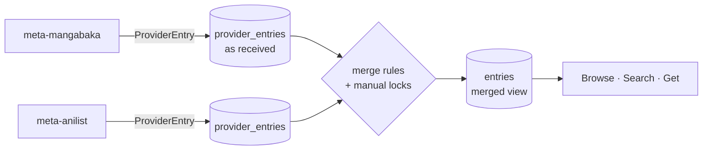

# Metadata entry schema

## Summary

The record shape that every metadata plugin sends and meta stores and serves. It starts from the owner's schema ideas (IN-0010 §2), which followed MangaBaka. The keeper made it **generic**, so any provider (API, scrape or dump) can fill whatever it knows (IN-0010 §1):

- one **credits** list with roles, instead of separate authors / artists / editors lists;
- **genres are tags** with a flag;
- **images** have a list of variants, not fixed widths;
- **every enum also keeps the provider's raw value**;
- each provider's record is **stored as it came**, and meta builds the merged view on top.

Status `proposed`: the meta session refines it in `metadata.v1` and REPORTs changes.

**Naming:** meta's catalogue item is an **Entry** (the owner's term). server's **Work** is the library's canonical series, and it *links* to an Entry ([domain model](../architecture/domain-model.md)). The two stay separate on purpose.

## Two layers

- **`ProviderEntry`:** what one provider says about one item, keyed by `(provider, external_id)`. It uses the full schema below and keeps a `raw` JSONB of the original. Re-ingesting replaces it.
- **`Entry`:** meta's merged record with its own ID. It links to one or more ProviderEntries (the cross-reference). Each field is picked by **provider priority per field** (configurable; MangaBaka first by default), then **manual locks** win. A curator can pin a field to a value or to a provider, *arr*-style. Each field also records which provider it came from, for attribution.
- **Linking:** shared external IDs link ProviderEntries to the same Entry. For example, MangaBaka's `source` map gives AniList, MAL and MangaUpdates IDs. Without one, a match goes to the matcher (later). Merges (`merged_with`) become redirects.

## Entry

| Field | Type | Notes |
|---|---|---|
| `id` | meta ID | Time-sortable. *Suggestion:* UUIDv7 in a Postgres `uuid` column (the owner's ideas used ULIDs; both sort by time) |
| `type` | EntryType | See enums |
| `status` | EntryStatus | Publication status |
| `content_rating` | ContentRating | |
| `titles[]` | Title | **All** titles: main, native, romanized, alternatives and per-language secondary titles |
| `descriptions[]` | `{language, text, source}` | One per language, Markdown or plain text |
| `credits[]` | Credit | People and their roles: authors, artists, editors, voice actors, … |
| `companies[]` | CompanyCredit | Publishers, magazines, imprints, licensors, studios, … |
| `licenses[]` | `{language, licensed, date?, company?}` | Licensing per language or region |
| `tags[]` | TagAssignment | Genres are tags with `is_genre` |
| `relations[]` | Relation | To other Entries |
| `adaptations[]` | Adaptation | Anime, live action, games, … (another medium, possibly not in meta) |
| `items[]` | Item | Known releases: chapters, volumes, issues, … |
| `progress` | `{total: Ref?, latest: Ref?, final: Ref?}` | e.g. total 12 volumes, latest chapter 108, final "volume 12 (exact)" |
| `dates` | `{announced?, start?, end?}` | PartialDate |
| `original_language` | BCP 47 | |
| `images[]` | Image | Cover, banner, … |
| `links[]` | Link | Official site, stores, read/stream links, wikis, socials |
| `external_ids[]` | `{provider, id, url?}` | AniList, MAL, MangaUpdates, Kitsu, MangaDex, ComicVine, ISBN, … |
| `stats` | `{rating?, rating_count?, popularity?, rank?}` | Per provider. The merged view keeps each one with its provider; they aren't comparable |
| `state` | `active` · `merged` · `removed` | `merged_into` when merged |
| `created_at`, `updated_at` | timestamp | |

## Building blocks

| Block | Fields |
|---|---|
| **Title** | `text`, `language` (BCP 47 + script, e.g. `ja-Latn`), `kind` (official · native · romanized · alternative · unofficial · unknown), `is_primary`, `traits[]` (free strings, e.g. `abbreviation`, `old`), `note` |
| **PartialDate** | `year`, `month?`, `day?` (+ optional time and zone for datetimes). Many sources only know a year |
| **Ref** | `unit` (RefUnit) + `qualifier` (exact · approximate · estimated · before · after · up_to · through · unknown) + `value` (string, so "12.5" and "Extra" fit) |
| **Item** | `unit`, `number?`, `value`, `name?`, `description?`, `release_date?` (PartialDate), `language?`, `links[]` |
| **Credit** | `person` (Person ref), `role` (PersonRole), `raw_role`, `character?` (`{name, name_original}` for voice actors), `order?`, `note?`, `period?` (joined/left PartialDate) |
| **CompanyCredit** | `company` (Company ref), `role` (CompanyRole), `raw_role`, `order?`, `note?`, `period?`, `links[]` |
| **TagAssignment** | `tag` (Tag ref), `weight?` (core · defining · recurrent · incidental · unweighted), `score?` (0–1 from votes where the provider has them), `is_spoiler` (for this entry) |
| **Relation** | `type` (RelationType), `target` (Entry ref, or an external ref not yet in meta), `chronology` (narrative · release · unknown), `manual`, `note?` |
| **Adaptation** | `type` (AdaptationType), `title`, `start?`/`end?` (Ref in the source work), `dates` (announced/start/end), `external_ids[]` |
| **Image** | `kind` (cover · banner · thumbnail · portrait · logo · other), `url`, `format?`, `width?`, `height?`, `file_size?`, `sha256?`, `blurhash?`, `thumbhash?`, `variants[]` (`{width, density, url}`, e.g. 250 @2x), `language?` (covers differ by edition) |
| **Link** | `type` (LinkType), `url`, `title?`, `description?`, `language?`, `platform?` + `handle?` for social links |

## Shared entities

Stored once and referenced from many entries. Each has its own `external_ids[]`, so providers link them up as they do entries.

| Entity | Fields |
|---|---|
| **Person** | `name`, `name_original?`, `aliases[]`, `aliases_original[]`, `birth?`/`death?` (PartialDate), `gender?`, `country?`, `language?`, `biography?`, `images[]`, `links[]` (social links included), `external_ids[]` |
| **Company** | `name`, `name_original?`, `aliases[]`, `aliases_original[]`, `type` (CompanyType), `status` (active · inactive · defunct · merged · acquired · renamed · unknown), `founded?`/`closed?`, `country?`, `language?`, `description?`, `images[]`, `links[]`, `external_ids[]` |
| **Tag** | `name`, `description?`, `parent?` (hierarchy), `level?`, `implied_by[]`, `is_genre`, `is_spoiler`, `is_explicit`, `content_rating`, `entry_count` (computed), `aliases[]`, `external_ids[]` |

Plain-string people (MangaBaka has `authors[]`/`artists[]` as strings) become Persons with no external IDs. Later, a provider that has IDs (e.g. AniList staff) can link them.

## Enums (from the owner's lists)

Every enum value travels with the provider's **raw string** (`raw_type`, `raw_role`, …). A provider that has a value outside our list maps it to `other`/`unknown` and the original is kept. Adding a value is non-breaking.

| Enum | Values |
|---|---|
| **EntryType** | novel, light_novel, web_novel, manga, manhwa, manhua, oel, comic, western_comic, graphic_novel, webcomic, webtoon, doujinshi, one_shot, anthology, visual_novel, artbook, guidebook, magazine, fanfic, other |
| **EntryStatus** | releasing, completed, hiatus, cancelled, upcoming, unknown |
| **ContentRating** | safe, suggestive, erotic, pornographic, unknown |
| **RefUnit** | chapter, volume, part, arc, act, season, cour, episode, special, ova, ona, movie, film, short, book, novel, light_novel_volume, issue, page, route, scenario, game, dlc, stage, track, whole_work, other, unknown |
| **PersonRole** | author, artist, writer, illustrator, original_creator, director, producer, screenwriter, character_designer, animator, composer, voice_actor, actor, translator, editor, publisher, studio_staff, other, unknown |
| **CompanyRole** | original_publisher, publisher, imprint, magazine, studio, animation_production, production, production_committee, distributor, licensor, localizer, streaming_service, platform, record_label, music_production, game_developer, game_publisher, sponsor, other, unknown |
| **CompanyType** | publisher, imprint, magazine, studio, animation_studio, production_company, production_committee, distributor, licensor, localizer, translation_group, streaming_service, platform, retailer, record_label, music_production, game_studio, software_company, agency, talent_agency, other, unknown |
| **RelationType** | adaptation, alternative, cameo, character_focus, compilation, contains, crossover, expansion, main, parent, parody, prequel, reboot, remake, sequel, series, side_story, source, spin_off, summary, uncollected, other |
| **AdaptationType** | anime, anime_movie, anime_short, anime_ova, anime_ona, anime_special, live_action_series, live_action_movie, live_action_special, tv_drama, movie, short_film, web_series, animated_series, animated_movie, game, visual_novel, audio_drama, radio_drama, stage_play, musical, doujin, spin_off, unknown |
| **LinkType** | official_website, official_profile, personal_website, portfolio, blog, wiki, database, encyclopedia, social, store, shop, merch, publisher, magazine, label, studio, streaming, watch, read, news, interview, article, review, image_gallery, video, trailer, forum, community, discord, reddit, donation, email, other, unknown |

## What changed from the owner's ideas, and why

| Owner's idea | Here | Why |
|---|---|---|
| `title`, `native_title`, `romanized_title`, `alternative_titles`, `secondary_titles` by language | One `titles[]` with `kind`, `language`, `is_primary` | Providers disagree on which title is "main"; one list holds them all and the merged view picks |
| Title flags `primary/official/native/alternative` plus a `type` | `kind` + `is_primary` | The flags repeated the type |
| `authors`, `artists`, `editors`, `people` lists | One `credits[]` with `role` | Any provider's roles fit, and new roles need no schema change |
| `companies` + `publishers` | One `companies[]` with `role` | Same |
| `genres` + `tags` | Tags with `is_genre`; per-entry `weight`, `score`, `is_spoiler` | A genre in one provider is a tag in another; spoilers often depend on the entry |
| Fixed image widths 150/250/350 @x1–x3 | `variants[]` | Other providers ship other sizes |
| `sources` / `sources_by_type` | `external_ids[]` plus stored ProviderEntries | Covers cross-references and provenance |
| `last_item`, `total_items`, `final_ref` | `progress {total, latest, final}` as Refs | One shape for all three |
| `description` (one) | `descriptions[]` per language | Multi-language providers |
| — | `raw_*` next to every enum, `raw` JSONB per ProviderEntry | Nothing a provider sends is lost when our enums don't fit |
| — | `stats` per provider | Ratings aren't comparable across providers |

## As built (meta slice 2, `d9e0aed`)
- `PartialDate.estimated` (MangaBaka flags estimated dates).
- `CompanyCredit.language` (publishers per market).
- `stats`: `popularity` (score) and `popularity_rank` (position) are separate fields, and ratings use a 0–100 scale.
- `ProviderEntry.url` and `updated_at`.
- `Relation` carries the target `ExternalId`, an `entry_id` set by meta, and a `title`.
- Persons, companies and tags carry a meta `id` that plugins leave empty.

## Working assumptions (meta slice 3, `e49bbce`; not owner decisions)
- **Merge on write:** each provider-record change rebuilds the entry and its parts; reads never merge.
- **Linking rule:** a provider record joins the entry that shares any of its external IDs, **except** two active records from the same provider are never joined (that provider says they are different works; guards against duplicates sharing an AniList ID).
- **Name-only persons and companies** (no IDs) are shared by normalized name; ones with IDs stay separate even when names match. Known limit: namesakes without IDs collapse into one person.
- **Tags** are shared by normalized name; genres are tags with `is_genre`.
- **Postgres 14+** documented (CI runs 18); only `pg_trgm` needed, title normalization happens in Go.

## Open (for the meta session to settle by REPORT)
- ~~How the merged view is computed~~: on write (working assumption above). The proto messages are built (see As built).
- The default per-field provider priority. *Suggestion:* MangaBaka for titles, IDs and tags; AniList for people and characters once it exists.
- Characters ([Q-0023](../questions/README.md)) are left out for now. `Credit.character` covers voice-actor credits only.
