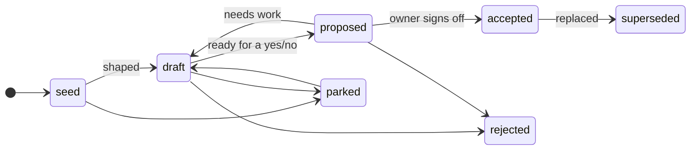

# Knowledge base conventions

How knowledge about **Panelarr** is written, organised and kept healthy. `python3 tools/kb.py check` enforces most of this page. Run it before every commit (the pre-commit hook does it for you).

## Areas

Each folder answers one question. Put an idea where its question is answered, and extend an existing doc before creating a new one.

| Folder | Holds | Question it answers |
|---|---|---|
| `product/` | Vision, principles, scope, personas | Why and what are we building, for whom? |
| `architecture/` | Cross-repo design: overview, domain model, deployment, security, repo standard | How do the pieces fit together? |
| `modules/` | One sub-folder per repo: role, boundaries, internals, implementation status | How is each repo built and what does it own? |
| `contracts/` | The reasoning behind APIs, protocols and file formats between repos | Why does each interface look the way it does? |
| `research/` | Facts about external projects, libraries, standards | What exists out there, and what did we learn? |
| `planning/` | Roadmap, milestones, features with acceptance criteria, releases, status reports | What gets delivered, and when? |
| `agents/` | Coding-session board, goal briefs, inbox for session messages | Who is working on what? |
| `qa/` | Test plans, test reports, regression list | Does it work, and how do we know? |
| `support/` | FAQ, known issues, reusable replies | What do users ask, and what do we answer? |
| `ops/` | Forge digests and the outbox of drafted comments and reviews | What's happening on the forges? |
| `playbooks/` | How the agent performs each role | How does the agent do its job? |
| `decisions/` | Decision records (ADRs) | What did we decide, and what did we reject? |
| `questions/` | Open-question register | What don't we know yet? |
| `inputs/` | The owner's words, verbatim and immutable | Where did an idea come from? |
| `journal/` | One entry per working session | What happened in each session? |
| `meta/` | Conventions, commit convention, protocols, authority, glossary, templates | How does this KB work? |

New top-level areas need an ADR. Sub-folders inside an area are fine whenever a topic outgrows one file. Index them in the area `README.md`.

**What vs how.** Product/vision docs say *what and why* and never assume an implementation. Architecture/tech docs say *how* and link to the *what* they serve. Research holds facts about other people's systems. Our own designs live elsewhere and cite research.

## Document anatomy

Every **knowledge doc** starts with YAML frontmatter. That means everything outside `inputs/`, `journal/`, `meta/templates/`, `agents/inbox/` and `ops/`, except `README.md` files:

```yaml
---
title: Offline sync                 # human title
status: draft                       # lifecycle below
tags: [sync, mobile]                # free-form, lowercase
related: [architecture/overview.md] # repo-relative paths (checked)
inputs: [IN-0002 §3]                # where the idea came from (optional)
updated: 2026-10-11                 # last meaningful change, YYYY-MM-DD
---
```

The body normally has:

1. **Summary**: 2–5 lines a newcomer can read on its own.
2. **Body**: the substance, in whatever structure fits.
3. **Open questions**: `Q-NNNN` links, or short inline bullets for minor ones.
4. **Related**: neighbouring docs, when not obvious from the text.

Templates live in [meta/templates/](templates/). `python3 tools/kb.py new <kind> "title"` fills one in, gives it the next free ID and adds the index row.

## Status lifecycle



| Status | Meaning | Who changes the content |
|---|---|---|
| `seed` | Captured, barely shaped | Anyone |
| `draft` | Being worked on, has open questions | Anyone |
| `proposed` | Coherent and waiting for the owner's yes/no | Anyone, but note changes in the journal |
| `accepted` | **Binding.** Work builds on it | Only with the owner's word or a new ADR. Commit with `!` |
| `parked` | Good idea, not now | Anyone can revive it |
| `rejected` | Considered and declined. Kept so it isn't re-litigated | Annotate only |
| `superseded` | Replaced. Must link to its replacement | Annotate only |

**Only the owner (@aurimasniekis) moves things to `accepted`.** Agents and contributors propose. Tentative words from the owner ("maybe…", "what if…", "thinking about…") mean `seed` or `proposed`, never `accepted`.

## Identifiers

| ID | Lives in | Notes |
|---|---|---|
| `ADR-NNNN` | `decisions/ADR-NNNN-slug.md` | Append-only. An accepted ADR is never rewritten. A newer one supersedes it |
| `Q-NNNN` | rows in `questions/README.md` | A big question also gets `questions/Q-NNNN-slug.md` |
| `IN-NNNN` | `inputs/IN-NNNN-slug.md` | Verbatim and immutable. Cite sections as `IN-0002 §3` |
| `FEAT-NNNN` | `planning/features/FEAT-NNNN-slug.md` | A feature with acceptance criteria (product owner) |
| `GOAL-NNNN` | `agents/goals/GOAL-NNNN-slug.md` | A brief dispatched to a coding session (agent manager) |

- Numbers are never reused, even when something is rejected.
- Docs are identified by their repo-relative path. Move them rarely, and fix links when you do (the checker catches broken ones).
- In team mode two branches can grab the same number. The checker flags duplicates. The later PR renumbers.

## Writing style

- Markdown. One topic per file. Split a file when it passes ~300 lines or covers two separable topics.
- Present tense, as if describing the finished thing ("The hub retries three times"). Mark uncertainty explicitly: *Possibly…*, **Open:**, **[unverified]**.
- **Keep the owner's voice and intent.** Don't flatten ideas into generic industry language, and don't quietly turn an optional thing into a mandatory one.
- Research separates **verified** facts (with source links and a "checked on" date) from **[unverified]** ones.
- Label suggestions as suggestions. Never present a working assumption as decided.
- Cite where an idea came from (`inputs:` in frontmatter, or `IN-0003 §2` inline).

## Confidential terms: aliases

Some names must never appear in the KB's text, its commits or anything public: a client, a partner, a codename, a person. Give each one an **alias** and write only the alias everywhere.

- The real terms live in **`.kb-aliases.env`** in the KB root. It is git-ignored and shared by hand with trusted people. The format is `ALIAS=real term`, with `|` between spellings: `FB=foobar|Foo Bar Inc`. The [template](templates/kb-aliases.env) explains it.
- Docs say `FB`. The agent reads the alias file, so it knows what `FB` means, and expands it only in conversation with the operator.
- Add an alias to the [glossary](glossary.md) as "alias; real name in `.kb-aliases.env`", never with the real term.
- `kb.py check` (and so the pre-commit hook) fails if a real term appears in any KB file, or if the alias file gets tracked by git. `kb.py ops post` refuses to post one. `kb.py leak-check` scans the code repos. Every message masks the term as `[FB]`.
- Missing the file? `kb.py aliases` lists what's defined. Ask the owner for it, and never guess the real terms.

## Diagrams and figures

- **Mermaid** inline is the default for flows, state machines, sequences and architecture. It is diffable.
- **SVG** for spatial or illustrative figures Mermaid can't do. Put it in a `figures/` folder next to the doc. Include a background `<rect>` (dark mode) and a `<title>`.
- Raster images (screenshots, references) also go in `figures/`, only when needed. Note their origin and licence.

## Indexes

- Every folder that holds docs has a `README.md` indexing each doc **with its status**.
- `kb.py check` requires each doc to be linked from its **nearest** README, and the status in the index row to match the doc's frontmatter.
- The root `README.md` indexes the areas.
- Update indexes in the same commit as the change.

## Generated and transient files

- `ops/digests/` and `ops/outbox/` are written by `kb.py ops`. They are not knowledge docs and don't need index rows.
- `agents/inbox/` is the drop folder where coding sessions leave messages. The keeper processes and archives them ([session protocol](session-protocol.md)).
