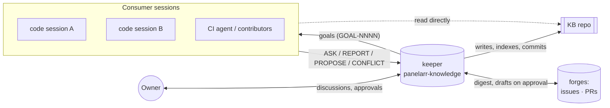

# Session protocol

How agent sessions and people share this KB. It is the **single source of truth** for Panelarr.

- **Keeper:** one long-lived agent session, **`panelarr-knowledge`**, curates the KB. It is also the operator's agent for the roles in [playbooks/](../playbooks/README.md): product owner, project manager, agent manager, QA, docs and support.
- **Consumers:** every other session (coding sessions in code repos or worktrees, a second UI session, a CI agent) and every human contributor.
- **Owner:** @aurimasniekis, the human who decides. Only the owner makes things `accepted`.



## Rules

1. **Consumers read freely.** Start at [README.md](../README.md), then the area index and the docs your task links to.
2. **Only the keeper writes knowledge.** Consumers never edit or commit KB docs. The one exception is the [inbox](../agents/inbox/README.md) drop folder.
3. **`accepted` docs are requirements.** Everything else is guidance. If work has to deviate from an accepted doc, send `CONFLICT:`. Never diverge silently.
4. **The keeper answers from the KB and cites paths.** If the KB doesn't know, the keeper says so, opens a `Q-NNNN`, and labels any suggestion as a suggestion. It never invents decisions.
5. **Working assumptions.** A consumer blocked on an undecided point may `PROPOSE:` a concrete assumption. The keeper records it as `draft` plus an open question for the owner. The consumer builds it **cheap to change** (config or data, not hard-coded) and never presents it as decided.

## Message kinds

Consumers prefix every message to the keeper with one of these:

| Kind | Purpose | Keeper's action |
|---|---|---|
| `ASK:` | "What does the KB say about X?" | Answer with paths. If it's unknown, open a Q and reply with its ID |
| `REPORT:` | "We built or decided X" (a fact from the work) | Record it (module/tech doc, goal status, sessions board), commit with a `Session:` footer, hand to QA if it is testable |
| `PROPOSE:` | "X should change or be added" | Record as `seed`/`draft`/`proposed`. Anything touching `accepted` waits for the owner |
| `CONFLICT:` | "Doc A vs doc B", or "the work can't satisfy doc A" | Open a Q, flag it to the owner, reply with the ID |
| `DONE:` | "Goal GOAL-NNNN finished; evidence attached" | Verify against the Definition of Done (QA playbook), update the goal and the board |

Example:

```
ASK: For sync conflicts, is last-write-wins acceptable or do we need merge?
```

Keeper reply:

```
Not decided. architecture/sync.md (draft) lists both options. Opened Q-0031.
Suggestion (not decided): last-write-wins per field, behind a config flag; REPORT what you build.
```

## Channels

Use whichever your agent platform supports, in this order:

1. **Native session messaging.** Some agent tools can message another running session directly. The message starts with the kind (`REPORT: …`).
2. **Inbox drop file.** Write `agents/inbox/YYYY-MM-DD-HHMM-<session>-<kind>.md` ([format](../agents/inbox/README.md)). This is the only place a consumer may write in this repo. The keeper processes it, records what matters and deletes or archives the file.
3. **Forge thread.** A comment on the goal's issue, or on the PR/MR. The keeper sees it in the next `kb.py ops digest`.

Humans use the forge: issues for ideas, questions, decisions and conflicts (CONTRIBUTING).

## Privacy mode (when the KB is private and the code is public)

If `privacy.enabled` is true in `kb.config.json`, then in **every public repo** (code, comments, docs, commit messages, branch names, PR/issue text, CI):

- **Never** mention this KB, its path, or that a private design repo exists.
- **Never** use KB identifiers (`ADR-`, `Q-`, `IN-`, `FEAT-`, `GOAL-` numbers) and never copy KB text verbatim.
- **Do** write self-contained public docs in each repo, explaining the *why* in your own words.
- **Do** run `python3 tools/kb.py leak-check` (from the KB) before pushing or opening a PR.

Confidential terms have aliases (`.kb-aliases.env`, [conventions](conventions.md#confidential-terms-aliases)). They apply in every repo, whether or not privacy mode is on. Consumers write the alias. If a session needs the real term, it asks the keeper, and the keeper answers in the conversation, never in a file.

Traceability then runs **one way only**: the KB records which commits and PRs implement what (`Implements:` footers, goal and module status sections).

## Keeper duties

- Keep the indexes, glossary, question register and sessions board current.
- After each discussion or batch of messages: journal entry, `kb.py check`, then commit if [authority](authority.md) allows.
- Watch for drift between REPORTs and docs. Either the doc changes (an ADR if it's accepted) or the consumer is told.
- Process the inbox and the digest every [ops round](../playbooks/ops-round.md).
