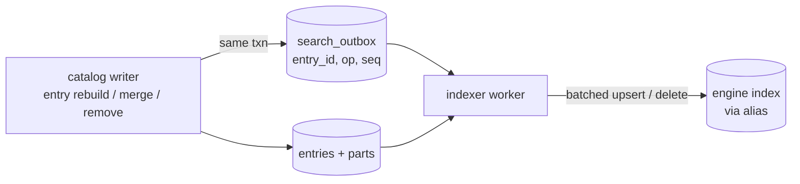

# meta search engine integrations (design)

## Summary

How meta plugs optional search engines (Typesense first, then Meilisearch) behind its existing `search.Index` interface ([FEAT-0001](../../planning/features/FEAT-0001-meta-search-engine-integrations.md)). Postgres stays the source of truth and the default backend. An engine is a rebuildable **read model**, fed by a **transactional outbox**, swapped atomically on rebuild, with **fallback to Postgres**. This is the keeper's design draft for a future goal. The session refines it.

## What exists today (meta `main`)

- `internal/search.Index` has `Query`, `Upsert`, `Delete`, `Rebuild` and `Capabilities` (`TypoTolerance`, `Substring`, `Facets`), plus `Filter`, `Sort` and `Hit` types. Only `Postgres` is implemented, and its `Upsert`/`Delete`/`Rebuild` are no-ops because it reads the tables directly.
- **The ingest path never calls `Upsert`/`Delete`.** An external engine therefore needs a change feed first; that's the core of this design.
- `search.backend` accepts only `postgres`.

## Change feed: transactional outbox



- **Outbox table** `search_outbox(seq bigserial, entry_id uuid, op text, enqueued_at)`. It is written **in the same transaction** as every entry rebuild, merge, retirement or removal in `internal/catalog`, so no change is lost and nothing is written twice by two systems.
- **Indexer worker:**
  - claims a batch (`FOR UPDATE SKIP LOCKED`) and coalesces by `entry_id` (the latest op wins);
  - loads the current entries, builds documents, and upserts or deletes in one engine bulk call;
  - deletes the claimed rows on success; on failure, backs off and retries (at-least-once; documents are idempotent by entry ID).
- **Lag** = the age of the oldest outbox row, exposed in health and the admin UI.
- **Floods** (first sync of ~300k, a big re-sync): when the outbox passes a threshold, or no index exists yet, the worker triggers a **Rebuild** instead and truncates the outbox up to the rebuild's start position.
- Only writes are tracked; Postgres needs no outbox, so with `backend: postgres` the outbox isn't written (config flag).

## Rebuild: build, then swap atomically

1. Create a new physical index `meta_entries_v{schema}_{timestamp}` with the current document schema and settings.
2. Note the outbox position, then stream every active entry in batches (JSONL import for Typesense, document batches for Meilisearch).
3. Replay outbox rows written during the build.
4. **Swap atomically:** Typesense collection alias, or Meilisearch `swap-indexes`. Then drop the old index.

Searches keep using the old index until the swap. The document **schema version** is stored with the index, so a changed schema triggers a rebuild on start.

## Document shape (one per active entry)

| Field | From | Notes |
|---|---|---|
| `id` | entry ID | The engine returns IDs only; meta loads entries from Postgres (as today) |
| `title` | display title | High weight |
| `titles_ja`, `titles_zh`, `titles_ko`, `titles_latn`, `titles_en`, `titles_other` | entry_titles grouped by language/script | Per-field locale: Typesense `locale`, Meilisearch `localizedAttributes`. Romanized (`*-Latn`) separate |
| `people` | credits (normalized names, original names) | Lower weight than titles |
| `genres`, `tags` | tag assignments | Facets; tags exclude spoiler-flagged ones from facets (suggestion) |
| `type`, `status`, `content_rating`, `original_language`, `title_languages[]` | entry | Filters and facets |
| `year`, `rating`, `popularity`, `popularity_rank`, `updated_at` | entry | Sorts; `popularity_rank` breaks relevance ties |

Descriptions are not indexed at first (size, noise); they can be added behind a setting. Merged and removed entries are deleted from the index; their redirects stay a Postgres concern.

## Query mapping

- `Filter` → engine filters: any-of for types, statuses, ratings, languages and genres; **all-of** for `Tags`; `NOT` for `ExcludeTags`; year range.
- `Sort` → `popularity_rank:asc`, `rating:desc`, `updated_at:desc`, `year:desc`, title; **relevance** = text match, then `popularity_rank`.
- **Browse** (no text) **stays on Postgres by default.** It is exact and consistent, and Postgres handles it in 15–60 ms at 54k entries. Engines serve **Search**, and Browse only when facets are requested (setting). *Suggestion; confirm with benchmarks.*
- **Facets:** a new optional `facets` field in the Browse/Search responses (an additive proto change), filled when `Capabilities.Facets`.
- **Limits:** Meilisearch reads only the first 10 query words, and `maxTotalHits` defaults to 1000. Raise it, and page within it, like Postgres's 1,000-candidate cap.

## Fallback and health

- If the engine errors or times out, or the index isn't built yet, that query is served by **Postgres**. Health reports `search: degraded (fallback)`, and the event is logged with rate-limiting.
- `/readyz` doesn't depend on the engine (meta stays usable). The admin UI shows backend, document count, lag, last rebuild and errors.

## Config and admin

```yaml
search:
  backend: typesense          # postgres (default) | typesense | meilisearch
  fallback: postgres          # on errors, query Postgres
  typesense: { url: http://typesense:8108, api_key: ${TYPESENSE_KEY}, index_prefix: meta }
  meilisearch: { url: http://meilisearch:7700, api_key: ${MEILI_KEY}, index_prefix: meta }
  outbox: { batch: 500, max_lag: 30s, rebuild_threshold: 50000 }
```

- In the admin (GOAL-0003), the search engine is an **integration**: connection, test, status and a "Rebuild" button. Engine keys are secrets: encrypted, never returned. The engine is never exposed to browsers.
- Compose profiles: `search-typesense` (Typesense, a volume, a generated key) and `search-meilisearch` (with `MEILI_NO_ANALYTICS=true`, MIT edition only).

## Engine notes

- **Typesense:** the index is in RAM (likely about 1–2 GB at our size, **[unverified]**). `infix` for substring matching costs memory: enable it only on the CJK title fields. The Go client lags (v3 stable, v4 alpha), so a thin REST client is an option.
- **Meilisearch:** best CJK tokenization (lindera, jieba) with per-attribute locales and atomic swaps. EE features (HA) need a commercial licence, so stay on MIT.
- **Postgres extensions** ([Q-0037](../../questions/README.md)): PGroonga's romaji/kana prefix (`&^~`) is attractive for Japanese, but it needs a superuser and a host install. It could only ever be an opt-in backend.

## Testing

- One **adapter conformance suite**, the same cases as today's Postgres search tests (romanized, Japanese substring, typo, person, filters, sorts, paging, merged excluded), run against each engine with testcontainers, plus outbox tests (restart, outage, flood → rebuild) and a swap test (queries during rebuild).
- Benchmarks on synthetic data at about 300k entries: index size and RAM, query p50/p95, rebuild time. The owner's real dump stays local ([Q-0022](../../questions/README.md)).
