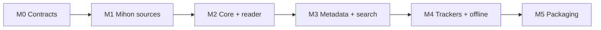

# Roadmap

## Summary

These milestones are proposals. Each one ends in something the author can run.

| Milestone | Delivers | Repos |
|---|---|---|
| **M0 Contracts** | KB. Repo standard and CI templates. `source-api` protos (v1) + Go SDK + conformance suite. Plugin host prototype | knowledge, source-api |
| **M1 Mihon sources** | mihon-source loads EXTREPO extensions (jar/APK) and serves source-api over gRPC + OpenAPI. Per-source OkHttp with proxy + FlareSolverr. Minimal admin SPA: sources, extension stores with signing, clients and API keys, integrations. source-mihon: role per Q-0026. Plugin index v0 | mihon-source, source-mihon, source-api |
| **M2 Core + reader** | server: users and auth, plugin host, network profiles, Works and source mapping, job queue, CBZ downloads, built-in FTS. source-local. web: library, browse, reader, downloads, admin | server, web, source-local |
| **M3 Metadata + search** | meta + `meta-mangabaka` (dump ingest) + `meta-anilist`. Matching UI. Typesense adapter. *The metadata protocol, meta service and `meta-mangabaka` start early, alongside M1 ([GOAL-0002](../agents/goals/GOAL-0002-meta-v0-metadata-protocol-meta-service-and-mangabaka-dump-in.md), IN-0009)* | meta, meta-mangabaka, server |
| **M4 Trackers + offline** | Tracker framework + AniList/MAL/MangaUpdates/Kitsu/… PWA offline chapters. Notifications. Mihon backup import | server, web |
| **M5 Packaging** | deploy: compose profiles, Unraid CA templates, docs site, AIO image | deploy |
